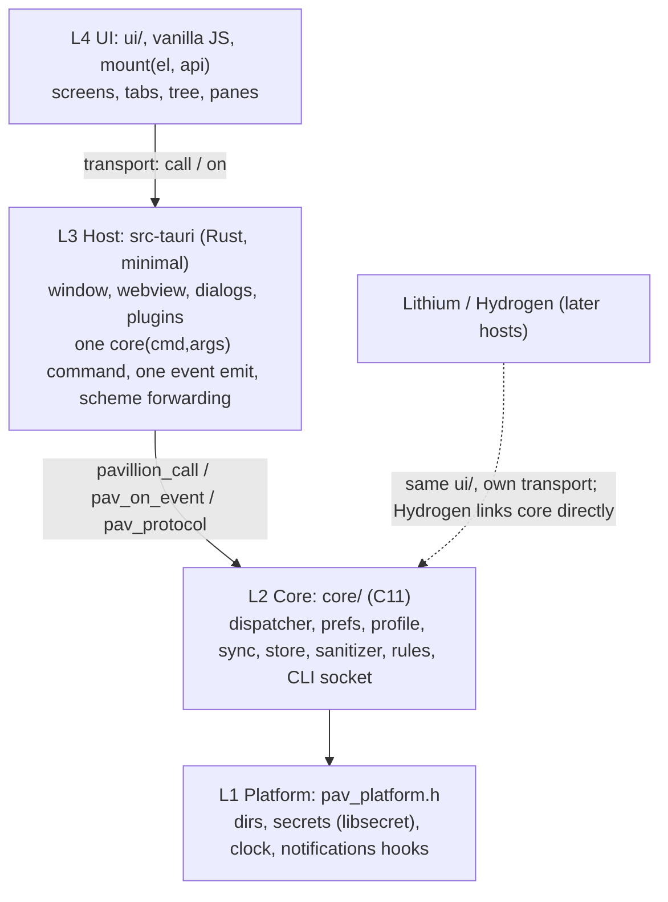
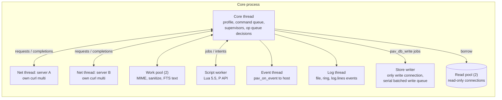

# Pavillion architecture

**Read this first.** This page is a map. The rules live in each document's Lock, and the order of work is in the index ([PAVILLION_PLAN.md](../PAVILLION_PLAN.md)). When this page and a Lock disagree, the Lock wins. Fix this page.

## Layers

Pavillion is a portable C11 core with a thin host around it. It will later be built into Hydrogen (C, in the [Philement repo](https://github.com/500Foods/Philement), `docs/H/`). So the core does all the work, and Rust/Tauri does only what needs Tauri ([G-LAYERS.md](G-LAYERS.md)).



- **L1** hides the OS: paths and modes, the keyring, time, and wake-ups. Linux is the v1 backend, and a fake backs the tests.
- **L2** is everything the user experiences except the pixels. Its whole surface is `pavillion_call(cmd, json)`, `pav_on_event`, and `pav_protocol` for the `pav-cid`, `pav-blob`, and `pav-link` schemes. Commands are listed in `docs/API.md`.
- **L3** forwards and nothing more. Any Rust beyond that needs a reason recorded in the G Lock.
- **L4** never talks to a server and never inserts outside HTML into the main document. Outside HTML goes in the sandboxed pane ([F-HARDEN.md](F-HARDEN.md)).

## Threads



- One store writer thread owns the only write connection. Every mutation (sync, rules, UI, CLI) is a job on its serial write queue, batched per transaction. Reads use a read pool of 2, so writes never see `SQLITE_BUSY` ([L-STORE.md](L-STORE.md)). Only the core thread writes the profile. The other threads talk to it through queues ([C-CORE.md](C-CORE.md), [M-SYNC.md](M-SYNC.md)).
- Each server endpoint has its own net thread and curl multi handle, and the accounts on that server are multiplexed on it. A slow server stalls only itself. Caps: 6 requests in flight per server, 2 per account, plus an optional overall cap.
- The script worker runs Lua with time and memory caps. It reads mail only through the `P` API and returns intents. The core applies the intents. The script thread never writes and never calls `pav_db_write` ([R-RULES.md](R-RULES.md)). The core thread never blocks on it.
- Every thread Pavillion creates uses a 512 KB stack ([C-CORE.md](C-CORE.md)).

## Data flow

```mermaid
sequenceDiagram
  participant S as Server (JMAP / IMAP / DAV)
  participant N as Net thread (per server)
  participant C as Core thread
  participant DB as SQLite + blobs
  participant R as Script worker (rules)
  participant UI as UI (L4)
  S->>N: push (EventSource) / poll
  N->>C: reduced rows, not the JSON body (M-4, M-5)
  C->>DB: store writer, one transaction per page
  C->>R: page posted; core does not wait
  R-->>C: intents (move, flag, label)
  C->>DB: store writer applies intents
  C-->>UI: mail.messages_changed (after rules, or after the page budget)
  UI->>C: user action (flag, move, delete)
  C->>DB: store writer, optimistic apply + op_queue row
  C-->>UI: change event (instant)
  C->>N: op flush with ifInState (M-6)
  N->>S: Email/set
  UI->>C: draft.send
  C->>DB: store writer, final draft.save op, outbox row
  C->>N: upload, Email/import, EmailSubmission/set (O-5)
  N->>S: send
  C-->>UI: outbox.update
```

- **Sync:** the server's changes come in on the net thread for that server, the store writer commits them, and only then does an event reach the UI. The UI then asks for the rows it shows. Bulk data never travels in events.
- **Rules on arrival:** new messages go through the rules between the store write and the announcement. So the UI sees a message already filed, and a rule's moves go out through the op queue like a user's.
- **User actions:** applied to the store first (the UI updates at once), then queued. The queue survives restarts and offline time, and it handles conflicts ([M-SYNC.md](M-SYNC.md) M-6). Undo is a held op.
- **Outbox:** sending is its own durable pipeline, not an op. It has undo-send and send-later, and failures stay visible and retryable ([O-COMPOSE.md](O-COMPOSE.md)).
- **Secrets:** passwords live in the keyring and are read on the net thread only for the request that needs them ([K-ACCOUNTS.md](K-ACCOUNTS.md)).
